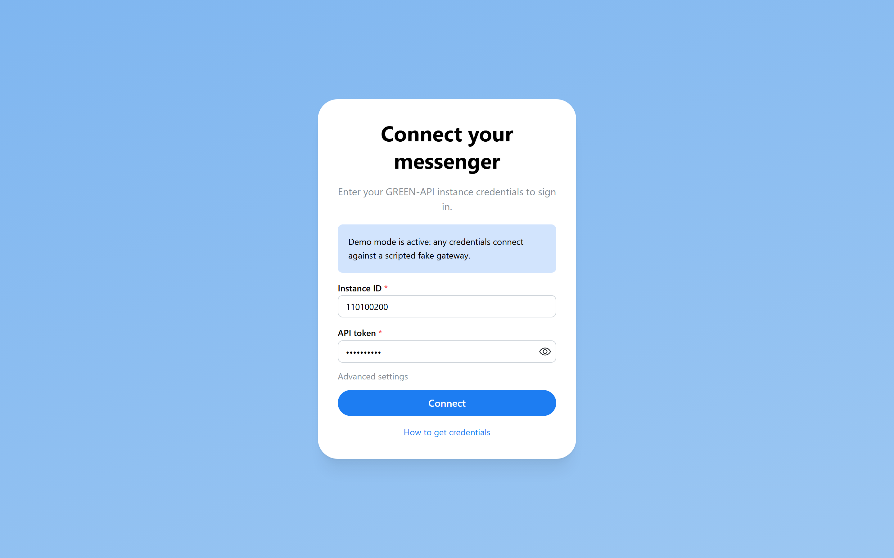
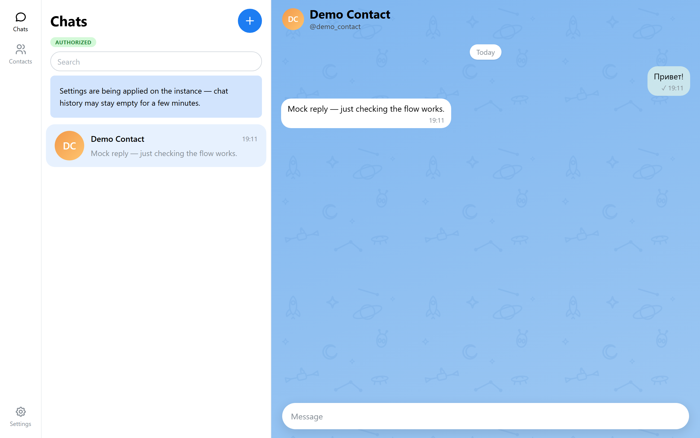
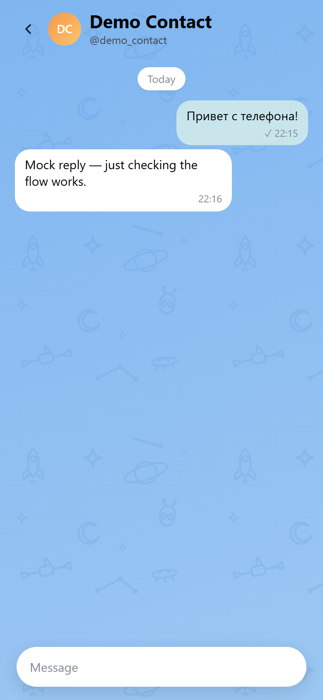

# Green API Messenger (Telegram)

A messenger web client built as a **test task for the “Фронтенд разработчик React” position at GREEN-API** ([vacancy](https://astana.hh.kz/vacancy/139289090), task text in `taskdesc.txt`). The task targets the MAX messenger via GREEN-API with Telegram explicitly allowed as an alternative — this project implements **Telegram** (the instance was registered and verified); because GREEN-API uses one unified gateway (`/waInstance{id}/{method}/{token}`) across WhatsApp, Telegram, and MAX, the same client can be pointed at a MAX instance by changing only credentials (see `docs/PLAN.md` §2).

Scope kept deliberately minimal per the task: **text-only messaging** — connect with GREEN-API credentials, create a chat by entering the recipient's phone number, send a message via `sendMessage`, receive replies live via the notification HTTP API long-poll, with a two-pane UI prototyped after [web.max.ru](https://web.max.ru/).

> Stack: Vite 8 · React 19 · TypeScript (strict) · Mantine 9 · TanStack Query 5 · Zustand 5 · Feature Sliced Design · Biome 2 · Vitest + Testing Library + MSW (test pyramid) · deployed to Railway.com

**Status: MVP-2 complete (T1–T8 on `main`), T9 hardening done — API client, session/connect/bootstrap, notification engine long-poll, chats/messages stores with history hydrate, unread counters, optimistic send, the MAX-Web chat list (nav rail, list pane, search, new-chat modal), the conversation pane (doodle wallpaper, floating header, day-grouped white/mint bubbles, status ticks, virtualized message list with scroll anchoring and jump-to-latest), the composer (floating pill with mic→send swap, Enter/Shift+Enter, 4000-char guard, offline disable, failed-bubble retry), MVP-2 credibility (background-chat unread toasts, connection chip with a reconnecting state + auto-reconnect banner, failed-bubble tooltip, mobile single-pane layout), the QA layer: Playwright e2e + axe, the full e2e scenario list, code-splitting with a <300 KB gzip initial budget, knip/commitlint/FSD-arch automation, and lefthook staging+push gates, and the deploy stack: nginx Docker runtime with SPA fallback + security headers + `/healthz`, `railway.toml` and the documented GitHub-connect / `railway up` flows (T10)** (see `docs/PROGRESS.md` for the live board).

## Requirements

- Node.js 22 LTS, pnpm 10+ (`packageManager` pins the exact version; Node 22 enforced via `engines` and `.nvmrc`)
- A GREEN-API instance (Telegram type) — [free "Developer" plan](https://green-api.com/telegram): register, pass Telegram authorization in their console, get `apiUrl`, `idInstance`, `apiTokenInstance`.

## Getting started

```bash
pnpm install
cp .env.example .env   # optional: pin VITE_API_MODE locally (gitignored)
pnpm dev
```

`pnpm dev` opens the **connect screen**: enter your GREEN-API `idInstance` and `apiTokenInstance` (apiUrl is editable under _Advanced settings_) and press _Connect_. The app validates the credentials via `getStateInstance`, persists the session in `localStorage` (survives reloads), and bootstraps the webhook settings (`incomingWebhook`, `outgoingMessageWebhook`, `outgoingWebhook`, `stateWebhook`) once via `SetSettings` — idempotent, `webhookUrl` stays empty. Since the instance applies settings server-side for up to ~5 minutes, a "settling in" notice is shown until then, and empty `getChatHistory` results are normal during that window. _Disconnect_ clears the stored session.

Mock/demo mode (no instance required): boot with `VITE_API_MODE=mock`, or open any page with **`?mock=1`** (runtime activation for reviewers — credentials are prefilled, any values connect). The scripted MSW fake gateway answers `getStateInstance`, `getSettings`/`setSettings`, `getContactInfo`, `getChats`, `getContacts`, `getAvatar` (no photo — initials fallback), `sendMessage` (echoes a delivery webhook and schedules a scripted incoming auto-reply ~1.2 s later so the receive flow can be demoed end-to-end), `getChatHistory` (newest-first journal of the mock message log), `readChat`, and the notification receive/ack pair. The demo contact `79991234567` resolves to a named profile; any other phone creates a chat named by the phone (mirroring live unknown-recipient behavior). Chat data (summaries and up to 200 messages per chat) persists in `localStorage` across reloads and is cleared on _Disconnect_. The mock layer ships in a deferred async chunk (loaded only when mock mode activates) and exposes fault-injection controls on `window.mockGateway` (`pollOutage` 500s to exercise reconnect recovery, `invalidate` to force a session-invalidating 401) that the e2e suite drives.

## Scripts

| Script                        | Purpose                                                                                   |
| ----------------------------- | ----------------------------------------------------------------------------------------- |
| `pnpm dev`                    | Vite dev server                                                                           |
| `pnpm build`                  | Type-check then production build to `dist/`                                               |
| `pnpm preview`                | Preview the production build                                                              |
| `pnpm lint` / `pnpm lint:fix` | Biome (check / check --write)                                                             |
| `pnpm typecheck`              | `tsc -b` over both TS projects                                                            |
| `pnpm test`                   | Vitest run with v8 coverage (thresholds enforced)                                         |
| `pnpm test:watch`             | Vitest in watch mode                                                                      |
| `pnpm test:e2e`               | Playwright e2e (mock mode; auto-starts the dev server)                                    |
| `pnpm check:arch`             | FSD import-direction check (downward layers, barrel-only cross-slice imports)             |
| `pnpm check:knip`             | knip dead-file / dead-dependency / dead-export sweep                                      |
| `pnpm check:bundle`           | Enforces the <300 KB gzip initial-payload budget against `dist/` (run after `pnpm build`) |
| `pnpm msw:init`               | Regenerate `public/mockServiceWorker.js` after MSW updates                                |

E2e runs against a Vite dev server launched in mock mode by Playwright (`webServer` in `playwright.config.ts`) — install the browser once with `pnpm exec playwright install chromium`, then `pnpm test:e2e`. Retries stay off locally so flake is caught honestly (`retries: 2` applies only under `CI`).

Every git operation is guarded by [lefthook](https://github.com/evilmartians/lefthook) hooks (installed automatically by `pnpm install` via the `prepare` script): `pre-commit` lints+formats only the staged files (`biome check --write --staged`) and runs `pnpm check:arch`; `commit-msg` enforces conventional commits via commitlint; `pre-push` runs `pnpm typecheck`, the full unit suite with coverage, and `pnpm check:knip`. `git commit --no-verify` / `git push --no-verify` skip them in emergencies. `BUILD_STATS=1 pnpm build` additionally emits a rollup-plugin-visualizer treemap (`bundle-stats.html`, gitignored) for bundle composition analysis.

## Environment variables

| Variable        | Meaning                                                             |
| --------------- | ------------------------------------------------------------------- |
| `VITE_API_MODE` | `live` (default, real GREEN-API calls) or `mock` (MSW fake gateway) |

That is the only build-time variable. GREEN-API credentials are never application-wide configuration: there are no `VITE_GREENAPI_*` env vars — `idInstance`/`apiTokenInstance` are entered on the connect screen per session, validated live, and stored only in the browser's `localStorage` (cleared by _Disconnect_). The repo never contains real instance data (`followup.txt`, `taskdesc.txt`, `redirect.pdf` stay gitignored).

## Project structure (Feature Sliced Design)

```text
src/
  app/        bootstrap, providers, mock worker wiring
  pages/      routed screens (connect, messenger shell)
  widgets/    layout blocks (nav rail, chat list pane, conversation, …)
  features/   user flows (connect session, open chat, pick chat, send message)
  entities/   live-sync stores (session, chats, messages) + chat UI (avatar, row) + message UI (bubble, date divider, status ticks)
  shared/     api client + rate queue, config (i18n, theme), ui, mocks, lib
```

Import direction is strictly downwards (app → widgets → features → entities → shared) and enforced by `pnpm check:arch` (same-layer cross-slice imports go through the slice's public API barrel; `shared` deep imports are allowed; `.module.css` cross-slice imports are the one pragmatic exception). Every slice exposes its public API via `index.ts`. UI copy lives in `src/shared/config/i18n.ts`.

## Testing

Pyramid per `docs/PLAN.md` §6: Vitest unit (mappers, phone normalization, rate queue), Vitest+MSW integration (notification engine, mock gateway contract), Testing Library component tests, and the Playwright e2e suite in mock mode (`pnpm test:e2e`): connect (valid/invalid credentials + inline validation), new chat by phone (known contact resolves by name, unknown keeps the phone), send/receive happy path, status ticks (sent→delivered→read escalation via `outgoingMessageStatus`), poll-outage/ reconnect recovery and session-invalidation flows, unknown-webhook resilience, reload persistence (session + chats + messages), the mobile single-pane layout with back navigation, the real-browser virtualizer/autoscroll check, background-chat unread toasts, and an axe pass with zero critical violations. Coverage thresholds (85% for `shared/**`, `entities/**`, `features/**`) are enforced on every `pnpm test` and the coverage artifacts (text, HTML, JSON summary) land in `coverage/`; initial payload is budget-checked by `pnpm check:bundle` (<300 KB gzip, currently ~157 KB with the mock layer and messenger page deferred).

There is no GitHub Actions pipeline by design: Railway builds and deploys `main`, and the task gate is `pnpm lint` · `pnpm typecheck` · `pnpm test` · `pnpm build` all green before every merge.

## Documentation

- `AGENTS.md` — binding conventions for AI coding sessions in this repo
- `docs/PROGRESS.md` — living task board + handoff between sessions (the development status lives here)
- `docs/PLAN.md` — architecture, verified API facts, UI spec, testing strategy, risks
- `docs/TASKS.md` — build roadmap decomposed into ordered tasks
- `docs/RESOURCES.md` — research index; `docs/resources/green-api/` — saved official API contract pages

## Security notes

- GREEN-API credentials grant full account access; never commit them, never share screenshots showing the token.
- Private task files (`followup.txt` with the real token, `taskdesc.txt`, `redirect.pdf`) are gitignored — they stay local forever.
- Rate limits apply per method (see `docs/resources/green-api/ratelimiter.md`); the client will respect them via the per-method rate queue (T1).

## Deployment

The app is a pure static SPA (GREEN-API sends `Access-Control-Allow-Origin: *` — verified live; no backend by design). Production runs on **Railway.com** as an nginx Docker container; Railway is the delivery pipeline (there is no GitHub Actions pipeline). Config shipped in-repo:

| File                | Role                                                                                                                                                                                                                                                                                                 |
| ------------------- | ---------------------------------------------------------------------------------------------------------------------------------------------------------------------------------------------------------------------------------------------------------------------------------------------------- |
| `Dockerfile`        | Multi-stage build: `pnpm install --frozen-lockfile` + `pnpm build` on `node:22-alpine` (corepack pnpm per `packageManager`), then only `dist/` is copied into `nginx:alpine`, so the runtime stays a plain static host with a Docker `HEALTHCHECK` on `/healthz`.                                    |
| `nginx.conf`        | gzip · immutable 1-year cache for hashed `/assets/*` · `index.html` never cached (SPA entry is always revalidated) · SPA fallback via `try_files` so every route is refresh-safe · `X-Content-Type-Options: nosniff` + `Referrer-Policy: no-referrer` on every response · `GET /healthz` → `200 ok`. |
| `railway.toml`      | Pins the Dockerfile builder and points the Railway deploy healthcheck at `/healthz`.                                                                                                                                                                                                                 |
| `public/robots.txt` | Disallows all crawlers (personal test-task app).                                                                                                                                                                                                                                                     |

No build-time or runtime environment variables are required — credentials are entered by the user at the connect screen and live only in the browser's `localStorage`; the server serves static files and the browser talks to GREEN-API directly over its open CORS surface.

### Deploy — GitHub-connected service (recommended)

1. Push this repository to GitHub.
2. In [Railway](https://railway.com) → **New project → Deploy from GitHub repo** → pick the repo.
3. Railway builds the `Dockerfile` (`railway.toml` pins `builder = "DOCKERFILE"`); every push to `main` redeploys.
4. Service → **Settings → Networking → Generate domain** to publish the container port publicly.

### Deploy — CLI (`railway up`)

```bash
npm install -g @railway/cli
railway login
railway init
railway up
railway domain
```

**Deployed URL:** pending the first deploy — update this line with the Railway-generated domain.

### Live-run checklist (verify after each deploy)

- `GET /healthz` → `200 ok`.
- Open the root URL; force-reload arbitrary deep links (e.g. refresh after guard) — nginx falls back to `index.html`, no 404.
- Connect with a real GREEN-API instance (or `/?mock=1`) → chat list appears (settling notice first — see limitations).
- Create a chat by phone → send a message → reply arrives live → ticks escalate.
- Hard-refresh mid-session → session, chats and messages restore from `localStorage`.

## Reviewer guide

Fastest routes to try the app:

1. **Deployed demo — no instance needed**: open `https://<deployed-url>/?mock=1`. The scripted mock gateway connects instantly (any values accepted), the demo contact `79991234567` resolves by name, a sent message yields a live scripted reply ~1.2 s later, and `window.mockGateway` fault knobs (`pollOutage`, `invalidate`) let you exercise reconnect and session-invalidation recovery on demand.
2. **Your own free instance**: register at [green-api.com/telegram](https://green-api.com/telegram), pass Telegram authorization in their console, copy `idInstance` + `apiTokenInstance` from the console into the connect screen. Your real chats appear; read the limitations first — notably `readChat`.
3. **Local run**: `pnpm install` → `pnpm dev` (mock mode also works on the dev URL with `?mock=1`); run the pyramid yourself with `pnpm test` and `pnpm test:e2e`.

## Known limitations

- **Unread counters are client-side** — the Telegram gateway does not expose unread counts via `getChats`; badges reset when `localStorage` is cleared or on _Disconnect_.
- **Telegram phone caveat**: `checkWhatsapp` returns 404 on Telegram instances, so phone → chat resolution goes through `getContactInfo` with the `phone@c.us` form. Unknown recipients return an _empty profile_ (HTTP 200, not an error) — the chat is still created, named by the entered phone, and a first-ever incoming message enriches it.
- **`readChat` marks the linked real account's chats read** — opening a chat clears unread on the actual Telegram account behind the instance, not only inside this app.
- **History of messages received before the webhook flags were enabled** shows up only after logout + re-authorization of the instance (gateway journal behavior); until then the app treats an empty history as normal — live notifications keep flowing — and shows the "settling in" notice while the instance applies settings (~5 min).
- **Free "Developer" plan caps**: 3 chats, 100 availability checks — API limit errors surface as toasts.
- **Text-only scope**: media / edit / delete / reactions are deliberately out of scope; non-text journal entries and `isDeleted` items are skipped by the mappers.

## Screenshots

Captured in mock mode (`?mock=1`) — never with real credentials or chats:

| Screen                   |                                                 |
| ------------------------ | ----------------------------------------------- |
| Connect screen           |  |
| Chat list + conversation |     |
| Mobile single-pane       |           |

A live demo video (send → reply appears, mock mode, token never visible) is part of the submission package — see `docs/PLAN.md` §11.

## Submission package

Per the task instructions the final delivery is sent to hr@green-api.com: CV pdf / GitHub repo link / local-run instructions / deployed service link / screenshots. The checklist lives in `docs/PLAN.md` §11.

---

Built for the GREEN-API test task. The product homepage: [green-api.com/max](https://green-api.com/max) · [green-api.com/telegram](https://green-api.com/telegram).
